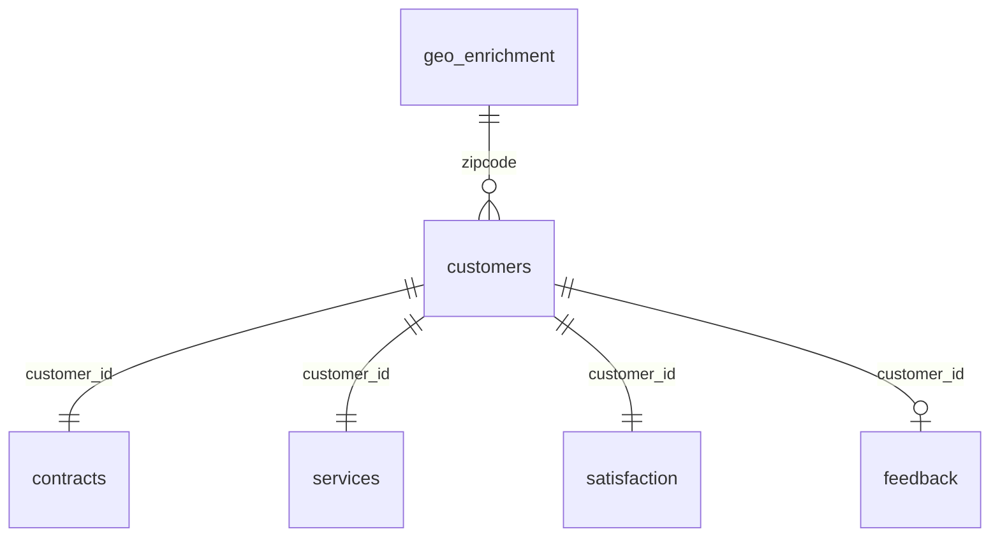

# Modèle physique de données (MPD) — PostgreSQL

Traduction physique des data contracts v0.4, organisée selon les couches du HLD.

| Fichier | Contenu |
|---|---|
| `ddl/01_schemas.sql` | Schémas `raw`, `staging`, `core`, `mart` |
| `ddl/02_raw.sql` | Une table par fichier source, colonnes `TEXT`, valeurs conservées telles quelles |
| `ddl/03_core.sql` | Modèle de référence typé : clés, domaines, bornes et règles de cohérence des contrats |

Les schémas `staging` et `mart` sont alimentés par dbt (P4 / P5).

## Couche CORE



| Table | Clé primaire | Source RAW | Contrat |
|---|---|---|---|
| `core.geo_enrichment` | `zipcode` | `raw.census_zcta` | enrichissement_geo v0.1.0 (hors MVP v1) |
| `core.customers` | `customer_id` | `raw.telco` | client v0.2.0 |
| `core.contracts` | `customer_id` | `raw.telco` | contrat v0.4.0 |
| `core.services` | `customer_id` | `raw.telco` | services v0.2.0 |
| `core.satisfaction` | `customer_id` | `raw.telco_satisfaction` | satisfaction v0.3.0 |
| `core.feedback` | `customer_id` | `raw.telco_noisy_feedback` | feedback v0.4.0 (une ligne par avis) |

**Choix de modélisation**
- Tables et colonnes nommées en anglais, alignées sur le MCD / MLD ; `snake_case` (`customerID` → `customer_id`, `nb_appels_support` → `support_calls_count`). Les tables `raw.*` gardent les noms des fichiers sources.
- Champs `Yes/No` et `0/1` typés `BOOLEAN`.
- Contraintes nommées `ck_<table>_<règle>` / `fk_<table>_<cible>` : chaque rejet est rattaché à une règle du contrat.
- Les `CHECK` portent uniquement des règles métier (montants et ancienneté `>= 0`, `tenure = 0 ⇒ total_charges = 0`). Les bornes observées dans le snapshot (`tenure ≤ 72`, `monthly_charges` 18,25–118,75, `total_charges ≤ 8 684,80`) et la réciproque `total_charges = 0 ⇒ tenure = 0` relèvent de tests dbt de sévérité `warn`.
- Domaine de `main_contact_reason` (`motif_contact_principal`) : les 8 valeurs observées.
- `core.feedback` ne contient une ligne que lorsqu'il y a un verbatim (cardinalité 0,1) : les lignes sans avis sont écartées en STAGING, et `has_feedback` se déduit en MART par jointure externe. `sentiment` est la polarité TextBlob 0.20.1 du verbatim.
- Règles inter-champs du contrat services (`ck_services_phone_consistency`, `ck_services_internet_consistency`) : « No phone service » si et seulement si `phone_service` est faux, « No internet service » sur les six options si et seulement si `internet_service = 'No'`.

## Lancer la base et contrôler les données

```bash
cp .env.example .env              # renseigner POSTGRES_PASSWORD
docker compose up -d              # PostgreSQL 16, DDL appliqué au premier démarrage
poetry run python scripts/check_mpd_conformance.py                  # données RAW telles quelles
poetry run python scripts/check_mpd_conformance.py --staging-rules  # avec les règles STAGING proposées
```

Le script charge les sources dans `raw`, insère chaque ligne dans `core` et rattache chaque rejet à la contrainte violée. Il vide les tables `raw.*` et `core.*` : à lancer uniquement sur une base de développement.

Prérequis : `data/raw/` extrait de `data-enrichi.zip` et `data/processed/census_zcta_2022.csv` produit par le notebook 3.0.

**Résultat de référence**

| Table CORE | Lignes source | Rejets (RAW tel quel) | Avec règles STAGING |
|---|---|---|---|
| `geo_enrichment` | 15 | 0 | 0 rejet |
| `customers` | 7 043 | 0 | 0 rejet |
| `contracts` | 7 043 | 11 · `total_charges` vide (tenure = 0) | 0 rejet |
| `services` | 7 043 | 0 | 0 rejet |
| `satisfaction` | 7 043 | 0 | 0 rejet |
| `feedback` | 7 032 | 5 274 · verbatim absent, 1 758 · `customer_id` en minuscules | 5 274 lignes sans avis écartées, 1 758 avis acceptés, 0 rejet |
